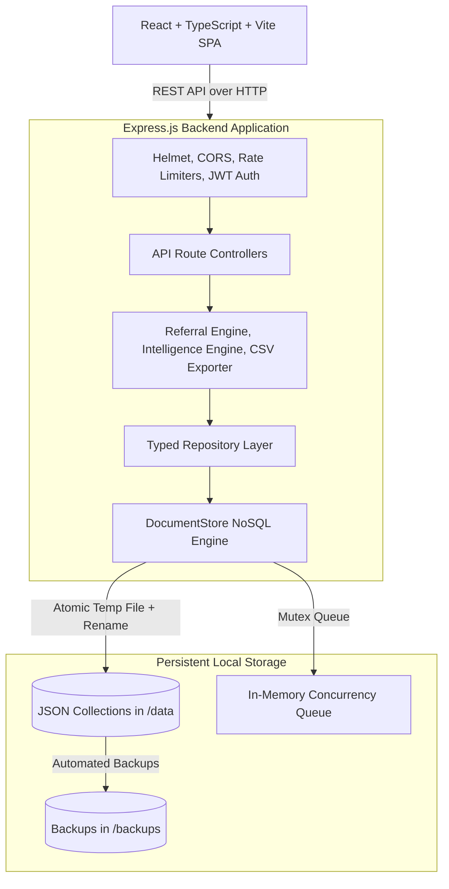
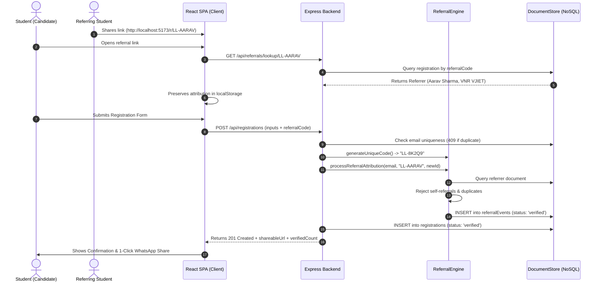

# LaunchLoop AI — System Architecture & Technical Specifications

**Product Name:** LaunchLoop AI  
**Tagline:** *Turn one registration into a campus-wide movement.*  
**Operating Environment:** Fully local Node.js / Express / React / TypeScript system with zero cloud or paid API dependencies.

---

## 1. System Overview & Component Diagram

LaunchLoop AI is architected as an integrated single-process full-stack web application designed for high-conversion student acquisition, viral peer referral tracking, campaign telemetry, and explainable growth intelligence.



---

## 2. Local NoSQL Document Database Architecture

The persistence layer is a custom, file-based NoSQL document repository that adheres strictly to the challenge constraint: **no SQLite, no MongoDB, no Redis, no PostgreSQL, and no external database servers.**

### Directory Structure & Logical Collections
All persistent data resides in standard JSON files within the dedicated root `data/` directory:
* `data/registrations.json`: Student registration profiles, degree/branch, contact consent, referral codes, and UTM tags.
* `data/referralEvents.json`: Immutable audit ledger of verified peer referral attributions.
* `data/campaigns.json`: Campaign metadata, targets (500 registrations), and date parameters.
* `data/campaignLinks.json`: Tracked acquisition links with UTM sources, clicks, and conversion rates.
* `data/budgetEntries.json`: ₹2,000 budget allocations, actual spend, and itemized expense audit logs.
* `data/campaignEvents.json`: Telemetry visit events, page impressions, and referral link clicks.
* `data/adminUsers.json`: Administrator credentials with bcrypt password hashes and roles.
* `data/campaignSettings.json`: 7-day pacing targets, workshop configuration, and demo mode flags.

### Core Repository Operations
The `DocumentStore` class implements high-level NoSQL primitives:
* `insertOne<T>(collection, doc)`: Generates collision-resistant unique ID, attaches ISO timestamps, enforces unique constraints, and writes atomically.
* `findOne<T>(collection, filter)`: Evaluates filter predicates against in-memory collection array.
* `findMany<T>(collection, filter, options)`: Filter, sort (`asc`/`desc`), skip, and limit documents.
* `findPaginated<T>(collection, filter, page, limit, sort)`: Returns slice with total count, page, and totalPages.
* `updateOne<T>(collection, filter, update)`: Safe mutation with timestamp update and unique constraint re-check.
* `deleteOne<T>(collection, filter)`: Removes document matching filter and persists updated state.
* `countDocuments<T>(collection, filter)`: Computes matching document counts.
* `aggregate<T, R>(collection, pipeline)`: Executes custom grouping and transformation functions.

### Concurrency & Durability Guarantees
1. **Atomic File Persistence:** Data is never written directly to the target file. Instead, it is written to `${filePath}.tmp.${timestamp}_${rand}` and swapped via `fs.promises.rename`.
2. **In-Memory Write Serialization (Mutex):** Node.js is single-threaded, but asynchronous file I/O operations can interleave. A dedicated `WriteQueue` per collection serializes write operations sequentially, preventing lost updates during concurrent student registrations.
3. **Windows File-Lock Resilience:** On Windows, `fs.rename` can throw `EPERM` or `EBUSY` if a file is momentarily locked by indexing or antivirus software. The engine implements an exponential retry loop (up to 6 attempts) with a fallback to `copyFile` + `unlink`.
4. **Safe Corruption Recovery:** If a file becomes corrupted (e.g. abrupt power cut), `readCollection` catches the JSON parse error, renames the corrupted file to `${filePath}.corrupt.${Date.now()}` for inspection, logs a warning, and safely initializes a fresh store without crashing the application.

---

## 3. End-to-End Registration & Referral Workflow



### Business Rules Enforced
1. **Collision-Resistant Code Generation:** 5-character alphanumeric strings using an unambiguous alphabet (`23456789ABCDEFGHJKMNPQRSTUVWXYZ`), avoiding confusing characters (0 vs O, 1 vs I).
2. **Anti-Self-Referral:** Server rejects any attribution where the referrer email matches the applicant email or applicant ID.
3. **Single Attribution Rule:** Each applicant receives exactly one valid referrer (first verified attribution is locked).
4. **Privacy Protection:** Emails and phone numbers are never exposed on the public leaderboard. Names are sanitized to first name and last initial (e.g. "Rahul S."). Opt-out requests (`shareOnLeaderboard: false`) omit students from public leaderboards.

---

## 4. API Endpoints Specification

### Public Routes
* `POST /api/registrations`: Public workshop registration endpoint. Rate-limited to 25 requests per 15 minutes per IP.
* `GET /api/registrations/status/:referralCode`: Public status lookup for confirmation and sharing screens.
* `GET /api/referrals/lookup/:code`: Public referral validation for welcome banners.
* `GET /api/referrals/leaderboard`: Public top 25 referral leaderboard with privacy filtering.
* `POST /api/campaigns/track`: Public telemetry tracker for page visits, referral clicks, and UTM tags.

### Admin Routes (Protected by `requireAdminAuth` Bearer Token)
* `POST /api/auth/login`: Admin authentication with bcrypt password verification (10 rounds). Rate-limited.
* `GET /api/auth/me`: Verifies active session token and returns admin profile.
* `GET /api/analytics/dashboard`: Command Center telemetries: KPIs, daily trends, channel breakdown, conversion rates, and college distribution.
* `POST /api/analytics/settings/toggle-demo`: Switches admin view between synthetic demo data and live clean data.
* `GET /api/registrations/admin`: Paginated registrations with search, college/channel filters, and masked emails.
* `GET /api/registrations/admin/export`: Downloads formula-injection-proof CSV of student registrations.
* `DELETE /api/registrations/admin/:id`: Removes a registration.
* `GET /api/campaigns/links`: Lists tracked UTM campaign links with click counts and conversion percentages.
* `POST /api/campaigns/links`: Generates a new tracked UTM URL.
* `PATCH /api/campaigns/links/:id`: Toggles active/paused state of a campaign link.
* `GET /api/referrals/admin/analytics`: Computes viral coefficient $K$, active ambassadors count, and referral trees.
* `GET /api/budget`: Category allocations, actual spend, remaining budget, and CAC calculations.
* `POST /api/budget/expense`: Records an itemized expense. Enforces ₹2,000 cap; requires confirmation if exceeded.
* `PUT /api/budget/allocations`: Updates category planned amounts.
* `GET /api/budget/export`: Exports itemized expense audit logs to CSV.
* `GET /api/insights`: Evaluates telemetry against 6 deterministic growth rules and returns transparent recommendations.
* `GET /api/strategy`: 7-day plan, daily targets, actuals, pacing deficit, and corrective decision rules.
* `PUT /api/strategy/plan`: Updates daily targets and tactical activities.
* `GET /api/strategy/slides`: Serves structured content for the 5-slide challenge submission presentation.

---

## 5. Security & Privacy Architecture

1. **Password Hashing:** Passwords are never stored in plaintext. Hashed with `bcryptjs` using 10 salt rounds.
2. **Stateless JWT Authorization:** Protected admin endpoints require valid `Bearer <token>` headers signed with a server secret.
3. **In-Memory Rate Limiting:**
   * General API: 180 requests/min per IP.
   * Registration endpoint: 25 submissions/15 min per IP.
   * Admin Login: 15 attempts/15 min per IP.
4. **Security Headers:** `helmet` applies X-Content-Type-Options, X-Frame-Options, Strict-Transport-Security, and X-XSS-Protection.
5. **CSV / Spreadsheet Formula Injection Protection:**
   Cells beginning with `=`, `+`, `-`, `@`, `\t`, or `\r` are prepended with a single quote (`'`) to neutralize Dynamic Data Exchange (DDE) execution when opened in Excel or Google Sheets.
6. **NoSQL Injection Immunity:** The query engine uses strict property matching and Zod schema validation; client input cannot execute arbitrary file operations.

---

## 6. Backup, Recovery & Operational Scripts

```bash
# Initialize safe empty collections in data/
npm run db:init

# Seed 285 deterministic synthetic demo records (for demo presentations)
npm run db:seed

# Reset demo records while preserving real registrations
npm run db:reset

# Create timestamped snapshot in backups/
npm run db:backup

# Restore database from snapshot
npm run db:restore
```

---

## 7. Known Architectural Limitations

As required by challenge guidelines, we are candid regarding limitations:
1. **Single-Process Constraint:** This file-based NoSQL database is architected for single-process Node.js execution. Running multiple clustering instances (`pm2 cluster` or horizontal container replicas) without distributed locks could cause race conditions on the local JSON files.
2. **Memory Working Set:** The entire collection is loaded into memory during queries. This is exceptionally fast (sub-millisecond reads) for datasets under 100,000 records, but would require indexed B-tree disk paging for millions of rows.
3. **Disk I/O Latency:** Frequent disk writes under massive concurrent load ($>1,000$ writes/sec) could saturate OS disk write queues. For large enterprise production, migration to PostgreSQL or MongoDB would be recommended.
