# LaunchLoop AI — Seven-Day Growth Plan

**Campaign Title:** “Build Your First AI Project in 60 Minutes”  
**Organizer:** NxtWave  
**Objective:** Acquire 500 verified registrations from final-year engineering students in 7 days  
**Total Campaign Budget:** ₹2,000 (Hard Cap)  
**Blended CAC Target:** ₹4.00 per registered student  

---

## 1. Executive Summary & Core Thesis

Final-year engineering students in India face acute anxiety surrounding campus placements, technical interviews, and final-year capstone projects. While demand for AI literacy has skyrocketed, existing online content is polarized between superficial 5-minute video demos and daunting 40-hour theoretical courses.

**The Proposition:** A free, live, 60-minute practical workshop where students build and run their first working AI application, understand its software architecture, and walk away with a tangible, defensible project they can put on their resume.

**The Growth Mechanism (LaunchLoop):** We treat every registration not as the end of a transaction, but as the beginning of a campus viral flywheel. By combining campus ambassador distribution, WhatsApp peer-group networks, and a collision-resistant referral engine, LaunchLoop turns one registered student into a campus-wide movement.

---

## 2. Target Student Persona & Psychology

### Primary Cohort
* **Batch:** Final-year (2025 graduating batch) and pre-final year (2026 batch) engineering students.
* **Branches:** Computer Science & Engineering (CSE), Information Technology (IT), Artificial Intelligence & Data Science (AI/DS), Electronics & Communication (ECE).
* **Institutions:** Tier-2 and Tier-3 private technical colleges, state engineering universities (e.g., JNTU, Anna University, VTU affiliates), and autonomous engineering institutes across India.

### Key Pain Points
1. **Resume Inadequacy:** Generic tutorial projects (e.g., basic To-Do apps, standard calculators) are routinely dismissed by technical recruiters. Students need modern AI project bullets with architecture keywords (APIs, prompt orchestration, inference pipelines).
2. **Analysis Paralysis & Cloud Bill Dread:** Students want to learn AI but fear incurring unexpected credit card charges on cloud providers (AWS, GCP, OpenAI) or getting stuck in complex Python environment errors.
3. **Time Scarcity:** Juggling campus placement rounds, semester exams, and lab projects leaves students with zero tolerance for low-yield multi-week courses.

### Motivations to Register
* **Time-to-Value:** 60 minutes is an exceptionally low cognitive and schedule commitment.
* **Guaranteed Zero Cost:** Free workshop with zero paid API prerequisites.
* **Practical Project Asset:** Students leave with working code and an architectural understanding they can explain in interviews.
* **Peer Community Validation:** Learning alongside classmates from their own department.

---

## 3. Seven-Day Registration Acquisition Plan

### Total Goal: 500 Verified Registrations

| Channel | Target Registrations | Share of Total | Allocated Budget | Effective CAC | Tactical Execution |
| :--- | :---: | :---: | :---: | :---: | :--- |
| **Campus Clubs & Student Ambassadors** | **150** | 30% | ₹500 | ₹3.33 | Onboard 15 student leads across key technical colleges with copy kits and club noticeboard prints. |
| **WhatsApp Student Communities** | **140** | 28% | ₹300 | ₹2.14 | Micro-creative carousels distributed across departmental, class, and lab announcement groups. |
| **College Email & Department Bulletins** | **70** | 14% | ₹0 | ₹0.00 | Coordinated placement cell student rep announcements and newsletter inclusion. |
| **LinkedIn & Instagram Organic** | **60** | 12% | ₹0 | ₹0.00 | Student project breakdown clips, "Why 60 mins beats 10-hour tutorials", and alumni endorsements. |
| **Referral-Led Acquisition** *(Attribution Overlay)* | **80** | 16% | ₹0 | ₹0.00 | Post-registration peer viral loop (Target viral coefficient $K \ge 0.35$). |
| **High-Intent Promotional Experiment** *(Contingency)* | *(30-50)* | *(Overlay)* | ₹800 | ₹16-₹26 | Optional search experiment deployed only if organic pacing falls below Day 4 targets. |
| **Contingency Reserve** | — | — | ₹400 | — | Capital reserve for emergency channel reinforcement. |
| **TOTAL** | **500** | **100%** | **₹2,000** | **₹4.00** | **Blended Campaign Performance** |

> **Critical Distinction on Referral Attribution:**  
> Referral-led acquisition is an *attribution overlay*. Referred students originally discover the workshop via WhatsApp or ambassador links, but register through a peer's unique link. This double-attribution model is accounted for in LaunchLoop AI to avoid double-counting top-of-funnel reach.

---

## 4. Seven-Day Execution Timeline & Daily Milestones

```mermaid
gantt
    title Seven-Day 500-Registration Acquisition Timeline
    dateFormat  X
    axisFormat Day %d
    section Ambassadors
    Ambassador Kit & Club Onboarding :0, 2
    section WhatsApp
    Class Group & Lab Hub Distribution :1, 4
    section Institutional
    College Email & Placement Bulletins :2, 4
    section Organic Social
    LinkedIn & Instagram Teaser Blitz :3, 5
    section Viral Loop
    Referral Surge & Leaderboard Recognition :4, 7
    section Closeout
    Final 24-Hour Registration Sprint :6, 7
```



### Day 1: Foundation & Ambassador Launch
* **Daily Target:** 30 Registrations (Cumulative: 30)
* **Primary Channel:** Campus Clubs & Core Student Ambassadors
* **Key Activities:**
  * Brief 15 core engineering student ambassadors with verified tracking links and ready-to-share copy kits.
  * Print and place workshop notices on club noticeboards across 5 pilot engineering colleges.
  * Announce the student referral recognition program on college student hubs.

### Day 2: WhatsApp Class & Lab Group Rollout
* **Daily Target:** 50 Registrations (Cumulative: 80)
* **Primary Channel:** WhatsApp Student Communities
* **Key Activities:**
  * Coordinate message distribution across 35+ final-year class and lab WhatsApp groups.
  * Use the value-first hook: *"Skip the 20-hour video courses — build your first working AI project in 60 minutes this week."*
  * Monitor real-time click telemetry via LaunchLoop Campaign Links.

### Day 3: Department Placement & College Email Outreach
* **Daily Target:** 65 Registrations (Cumulative: 145)
* **Primary Channel:** College Email Bulletins & Placement Coordinators
* **Key Activities:**
  * Engage student placement coordinators to forward workshop notices to final-year email groups.
  * Publish the first public leaderboard update recognizing top student referrers.
  * Verify conversion rates across channels; apply copy adjustments if drop-off exceeds 90%.

### Day 4: Mid-Campaign Social Blitz & Pacing Audit
* **Daily Target:** 75 Registrations (Cumulative: 220)
* **Primary Channel:** LinkedIn & Instagram Organic
* **Key Activities:**
  * Publish short carousel: *"3 AI architecture patterns every 2025 engineering fresher needs on their resume."*
  * **Pacing Audit Rule:** If cumulative registrations are $< 70\%$ of 220 (i.e. $< 154$), trigger the automated decision rule: freeze experimental spending, double down on the top 2 highest-converting channels, and onboard 5 more student reps.

### Day 5: Tactical High-Intent Experimentation
* **Daily Target:** 85 Registrations (Cumulative: 305)
* **Primary Channel:** High-Intent Search / Targeted Communities
* **Key Activities:**
  * Deploy ₹400-₹800 experimental high-intent allocation targeting students actively searching for capstone project guidance.
  * Direct outreach to ACM, CSI, and IEEE college student branch heads.
  * Nudge existing registrants on WhatsApp: *"Bring your project partner so you can build together."*

### Day 6: Peer Referral Surge & Leaderboard Sprint
* **Daily Target:** 95 Registrations (Cumulative: 400)
* **Primary Channel:** Referral-Led Acquisition
* **Key Activities:**
  * Activate the referral viral loop: trigger automated in-app nudges to students with 0 referrals to unlock the Project Starter Kit.
  * Spotlight the top 3 student ambassadors on LinkedIn and WhatsApp groups.
  * Finalize department-level headcounts.

### Day 7: Final 24-Hour Registration Closeout
* **Daily Target:** 100 Registrations (Cumulative: 500)
* **Primary Channel:** Omnichannel Final Push
* **Key Activities:**
  * Last-chance reminder across all WhatsApp community hubs: *"Registrations close tonight at midnight."*
  * Final leaderboard snapshot; award proposed digital badges to top ambassadors.
  * Lock registrations, run data validation, and prepare workshop delivery pipelines.

---

## 5. Budget Allocation & Financial Discipline (₹2,000 Total)

The campaign operates under a strict ₹2,000 total expenditure ceiling. Paid experimentation is strictly optional and subordinate to organic campus distribution.

```
Total Budget: ₹2,000
├── ₹500 (25%)  — Campus Ambassador & Club Outreach (Flyers, physical posters, lead kit rewards)
├── ₹300 (15%)  — Student-Community Creative Distribution (Figma assets, WhatsApp carousel kits)
├── ₹800 (40%)  — Optional High-Intent Promotional Experiment (Capped search test)
└── ₹400 (20%)  — Contingency & Optimization Reserve (Emergency buffer)
```

### CAC & Unit Economics
* **Planned Acquisition:** 500 Students
* **Planned Expenditure:** ₹2,000
* **Blended Cost per Registration (CAC):** $\frac{₹2,000}{500} = ₹4.00$
* **CAC Excluding Paid Experiment:** $\frac{₹1,200}{450} = ₹2.67$

---

## 6. Decision Rules & Growth Intelligence Policies

1. **The 70% Pacing Rule:**
   $$\text{If } \frac{\text{Actual Cumulative Registrations}}{\text{Planned Cumulative Target}} < 0.70 \text{ at Day 4:}$$
   * **Action:** Freeze broad advertising spend immediately.
   * **Action:** Shift 100% of outreach effort to the two highest-converting campus channels.
   * **Action:** Recruit 5 additional student ambassadors from top-performing colleges before deploying contingency funds.

2. **The Funnel Friction Rule:**
   $$\text{If } \text{Channel Visits} \ge 20 \text{ and } \text{Conversion Rate} < 7.5\%:$$
   * **Action:** Inspect copy discrepancy between promotional creatives and the landing page hero title. Ensure the "Free + 60 Mins" guarantee is prominently visible above the fold.

3. **The Viral Acceleration Rule:**
   $$\text{If } \text{Referral Factor } K \ge 0.35:$$
   * **Action:** Publicly recognize top 3 student referrers on the leaderboard and grant priority workshop Q&A access.

---

## 7. Risk Analysis & Mitigation Matrix

| Risk | Severity | Probability | Mitigation Strategy |
| :--- | :---: | :---: | :--- |
| **WhatsApp Spam Fatigue** | High | Medium | Enforce a strict maximum of 2 high-value messages per group. Provide useful project architecture snippets rather than naked promotional links. |
| **High Form Abandonment** | Medium | Medium | Keep registration fields minimal. Phone number is optional with explicit consent. Instant client-side validation. |
| **Paid Experiment Underperformance** | Low | High | Treat paid ads as strictly optional. The entire plan is designed to achieve 450+ registrations purely through campus clubs, WhatsApp, and peer referrals. |
| **Self-Referral & Leaderboard Gaming** | High | Low | Enforce backend uniqueness constraints, block self-referrals by IP/email, and verify referral events server-side. |
